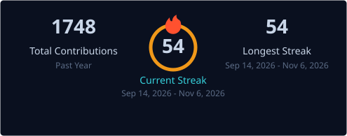

<picture>
  <source media="(prefers-color-scheme: dark)" srcset="https://raw.githubusercontent.com/SailikNanda/SailikNanda/main/assets/dark.svg" />
  <source media="(prefers-color-scheme: light)" srcset="https://raw.githubusercontent.com/SailikNanda/SailikNanda/main/assets/light.svg" />
  
</picture>

 

  <picture>
    <source media="(prefers-color-scheme: dark)" srcset="https://readme-typing-svg.demolab.com?font=Fira+Code&size=22&duration=3500&pause=1200&color=36D1DC&center=true&vCenter=true&width=620&lines=B.Tech+Student;AI+Agent+Builder;Building+ERA+%E2%80%94+a+personal+AI+Agent" />
    
  </picture>

<a href="#-about-me">About</a> &nbsp;·&nbsp; <a href="#-featured-project">Featured Project</a> &nbsp;·&nbsp; <a href="#-tech-stack">Tech Stack</a> &nbsp;·&nbsp; <a href="#-what-im-exploring">Exploring</a> &nbsp;·&nbsp; <a href="#-github-statistics">Statistics</a> &nbsp;·&nbsp; <a href="#-contribution-snake">Snake</a> &nbsp;·&nbsp; <a href="#-projects">Projects</a> &nbsp;·&nbsp; <a href="#-connect-with-me">Connect</a>

  <em><strong>B.Tech Student</strong> · <strong>AI Agent Builder</strong> · <strong>West Bengal, India</strong></em>

  
  
  
  
  

Profile at a glance

<table>
<tr>
<td width="50%">

**Education** · B.Tech, **MAKAUT** — Information Technology

</td>
<td width="50%">

**Building** · **ERA**, a personal AI agent

</td>
</tr>
<tr>
<td width="50%">

**Focus** · AI agents and voice-based interaction

</td>
<td width="50%">

**Based in** · West Bengal, India

</td>
</tr>
</table>

###  About Me

-  B.Tech Student (**MAKAUT**), **Information Technology** coursework
-  Building **ERA**, a **personal** AI agent
-  Currently exploring **AI models** as well as **AI configuration**
-  Based in **West Bengal, India**
-  Maintaining three public projects: **[Finera](https://github.com/SailikNanda/finance-tracker)**, **[Aurora VidGrab](https://github.com/SailikNanda/Aurora-Vidgrab)** and **[ERA System Prompts](https://github.com/SailikNanda/ERA-System-Prompts)**

###  Featured Project

<table>
<tr>
<td width="100%">

**ERA: Personal AI Agent**

A **long-term flagship** project: a **Jarvis-inspired** AI Agent that includes **voice-based interaction**, **agentic task execution**, and a **creative ecosystem** of tools — email, docs, PPT generation, image generation, object detection, and much more.

</td>
</tr>
</table>

###  Tech Stack

<picture>
  <source media="(prefers-color-scheme: light)" srcset="https://skillicons.dev/icons?i=python,pytorch,git,github,linux,vscode,html,js,react,nodejs,cloudflare,docker&theme=light" />
  
</picture>

<strong>Python</strong> &nbsp;·&nbsp; <strong>PyTorch</strong> &nbsp;·&nbsp; <strong>Git</strong> &nbsp;·&nbsp; <strong>GitHub</strong> &nbsp;·&nbsp; <strong>Linux</strong> &nbsp;·&nbsp; <strong>VS Code</strong> &nbsp;·&nbsp; <strong>HTML</strong> &nbsp;·&nbsp; <strong>JavaScript</strong> &nbsp;·&nbsp; <strong>React</strong> &nbsp;·&nbsp; <strong>Node.js</strong> &nbsp;·&nbsp; <strong>Cloudflare</strong> &nbsp;·&nbsp; <strong>Docker</strong>

###  What I'm Exploring

###  GitHub Statistics

<picture>
  <source media="(prefers-color-scheme: dark)" srcset="https://raw.githubusercontent.com/SailikNanda/SailikNanda/main/assets/streak-dark.svg" />
  <source media="(prefers-color-scheme: light)" srcset="https://raw.githubusercontent.com/SailikNanda/SailikNanda/main/assets/streak-light.svg" />
  
</picture>

 

<picture>
  <source media="(prefers-color-scheme: light)" srcset="https://github-readme-stats-rose-seven-63.vercel.app/api?username=SailikNanda&show_icons=true&hide_rank=true&custom_title=GitHub%20Stats&title_color=B45309&icon_color=0E7490&text_color=0A101F&bg_color=FFFFFF&border_color=E2E8F0&hide_border=true" />
  
</picture>
<picture>
  <source media="(prefers-color-scheme: light)" srcset="https://github-readme-stats-rose-seven-63.vercel.app/api/top-langs/?username=SailikNanda&layout=compact&title_color=B45309&text_color=0A101F&bg_color=FFFFFF&border_color=E2E8F0&langs_count=8&hide_border=true&card_width=495" />
  
</picture>

Left: overall GitHub statistics. Right: most-used languages.

 

 

&nbsp;&nbsp;

&nbsp;&nbsp;

&nbsp;&nbsp;

&nbsp;&nbsp;

 

 

Streak, trophy, activity and snake cards are generated by <strong>GitHub Actions</strong> in this repository and refresh every <strong>12 hours</strong>.

###  Contribution Snake

<picture>
  <source media="(prefers-color-scheme: dark)" srcset="https://raw.githubusercontent.com/SailikNanda/SailikNanda/output/github-contribution-grid-snake-dark.svg?v=1" />
  <source media="(prefers-color-scheme: light)" srcset="https://raw.githubusercontent.com/SailikNanda/SailikNanda/output/github-contribution-grid-snake.svg?v=1" />
  
</picture>

Each square is one day of contribution activity, shaded by how much was committed; the snake eats them in date order.

###  Projects

<table>
<tr>
<td width="100%">

#### [Finera](https://github.com/SailikNanda/finance-tracker)

An **offline-first** Android finance tracker, with **zero backend**.

</td>
</tr>
</table>

<table>
<tr>
<td width="100%">

#### [Aurora VidGrab](https://github.com/SailikNanda/Aurora-Vidgrab)

A **cross-platform** video and audio downloader spanning **1750+ sites**.

</td>
</tr>
</table>

<table>
<tr>
<td width="100%">

#### [ERA System Prompts](https://github.com/SailikNanda/ERA-System-Prompts)

**Mood-based** system prompts for the **ERA** AI agent.

</td>
</tr>
</table>

###  Connect With Me

&nbsp;&nbsp;
&nbsp;&nbsp;
&nbsp;&nbsp;
&nbsp;&nbsp;

<a href="https://github.com/SailikNanda?tab=repositories">Browse all repositories</a> &nbsp;·&nbsp; <strong>Thanks for stopping by</strong> — please feel free to explore the repositories.

 

